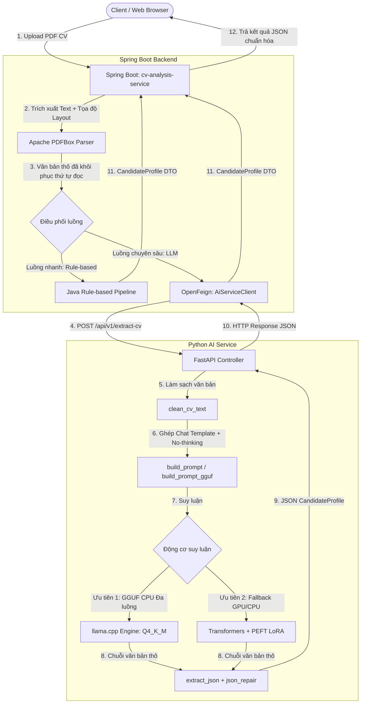
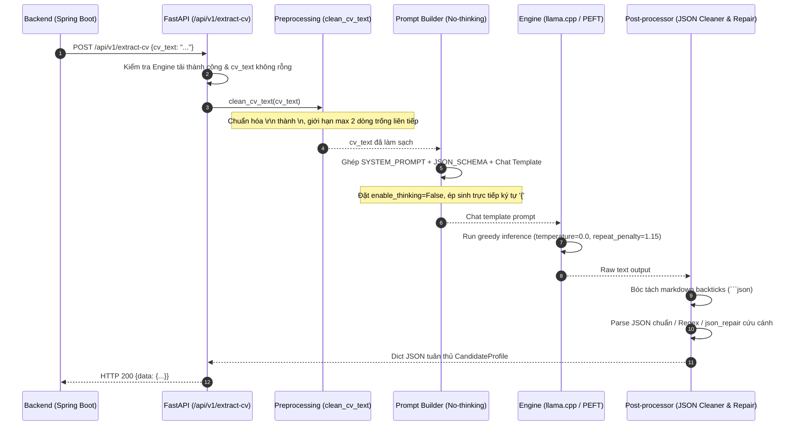
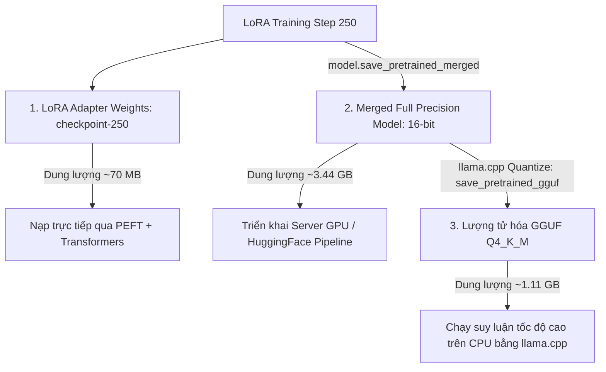

# TÀI LIỆU KỸ THUẬT CHI TIẾT: AI SERVICE & QUY TRÌNH FINE-TUNING LLM
> **Dự án:** Hệ thống Trích xuất Thông tin CV (CV Parsing) Hybrid (Rule-based & LLM)  
> **Dịch vụ:** `ai-service` (FastAPI / PyTorch / llama.cpp)  
> **Mô hình phục vụ:** Qwen3-1.7B LoRA Finetuned / GGUF Q4_K_M  

---

## MỤC LỤC
1. [Tổng quan Kiến trúc và Vị trí của AI Service](#1-tổng-quan-kiến-trúc-và-vị-trí-của-ai-service)
2. [Mô hình Ngôn ngữ Lớn Đang Sử Dụng (Model Specifications)](#2-mô-hình-ngôn-ngữ-lớn-đang-sử-dụng-model-specifications)
3. [Luồng Chạy Chi Tiết của AI Service (Inference Workflow)](#3-luồng-chạy-chi-tiết-của-ai-service-inference-workflow)
4. [Kỹ thuật Tối ưu Hóa Suy luận Đặc thù](#4-kỹ-thuật-tối-ưu-hóa-suy-luận-đặc-thù)
5. [Quy trình Fine-Tuning Toàn diện (Fine-Tuning Pipeline)](#5-quy-trình-fine-tuning-toàn-diện-fine-tuning-pipeline)
6. [Đóng gói, Chuyển đổi và Phục vụ Mô hình (Model Artifacts & Serving)](#6-đóng-gói-chuyển-đổi-và-phục-vụ-mô-hình-model-artifacts--serving)
7. [Hướng dẫn Cài đặt, Cấu hình và Vận hành Dịch vụ](#7-hướng-dẫn-cài-đặt-cấu-hình-và-vận-hành-dịch-vụ)

---

## 1. TỔNG QUAN KIẾN TRÚC VÀ VỊ TRÍ CỦA AI SERVICE

Hệ thống phân tích CV được xây dựng theo **Kiến trúc Lai (Hybrid Architecture)** nhằm đạt được sự cân bằng tối ưu giữa **tốc độ phản hồi**, **tính bảo mật**, **chi phí tính toán** và **độ chính xác**:
- **Backend chính (Spring Boot / Java)**: Đảm nhiệm nhận file PDF, điều phối luồng dữ liệu, lưu trữ cơ sở dữ liệu và vận hành bộ trích xuất **Rule-based nội bộ** (nhanh, tiêu tốn ít tài nguyên, đóng vai trò nòng cốt).
- **AI Service (FastAPI / Python)**: Chuyên trách nạp mô hình ngôn ngữ lớn (LLM) đã được tinh chỉnh (Fine-tuned), bóc tách ngữ nghĩa chuyên sâu cho các CV có bố cục phức tạp, cấu trúc phi chuẩn hoặc khi luồng Rule-based cần đối soát.



---

## 2. MÔ HÌNH NGÔN NGỮ LỚN ĐANG SỬ DỤNG (MODEL SPECIFICATIONS)

### 2.1. Lựa chọn Mô hình Nền (Base Model)
Dự án sử dụng mô hình nền **`unsloth/Qwen3-1.7B`** (thuộc dòng thế hệ mới của Alibaba Qwen Team).

| Tiêu chí | Qwen3-0.6B (Thử nghiệm cũ) | Qwen2.5-1.5B (Cũ) | **Qwen3-1.7B (Đang sử dụng)** |
| :--- | :--- | :--- | :--- |
| **Kích thước tham số** | 0.6 Tỷ (0.6B) | 1.5 Tỷ (1.5B) | **1.74 Tỷ (1.7B)** |
| **Độ hiểu tiếng Việt** | Trung bình, dễ nhầm từ viết tắt | Khá | **Rất tốt, văn phong kỹ thuật chuẩn xác** |
| **Khả năng tuân thủ JSON** | Dễ thiếu trường, sai cấu trúc | Tốt | **Tuyệt đối (100% hợp lệ qua Pydantic)** |
| **Độ dài ngữ cảnh (Context)** | 2048 tokens | 4096 tokens | **Mở rộng đạt 4096 tokens** |
| **Tài nguyên phục vụ (CPU)** | Rất nhẹ (~400MB) | Vừa phải (~1.1GB) | **Nhẹ, tối ưu cực tốt với GGUF Q4 (~1.11GB RAM)** |

### 2.2. Kiến trúc & Thông số Kỹ thuật
- **Kiến trúc mô hình**: `Qwen3ForCausalLM` với cơ chế Decoder-only Transformer, RoPE (Rotary Position Embedding), SwiGLU activations và RMSNorm.
- **Tổng tham số mô hình**: **1,738,007,552 tham số (~1.74B)**.
- **Số lớp biến đổi (Layers)**: 28 layers.
- **Hidden Size**: 2048.
- **Số Attention Heads**: 16 heads.
- **Độ dài ngữ cảnh tối đa**: **4096 tokens** (bao phủ trọn vẹn CV dài nhất 3964 tokens sau khi kèm System Prompt và Schema).

---

## 3. LUỒNG CHẠY CHI TIẾT CỦA AI SERVICE (INFERENCE WORKFLOW)

Khi nhận một request từ Backend, quá trình thực thi tại `ai-service/main.py` diễn ra qua 5 giai đoạn khép kín:



### Bước 1: Tiếp nhận Request & Kiểm tra trạng thái
- Endpoint: `POST /api/v1/extract-cv`
- Input DTO: `CVRequest` chứa trường `cv_text` (chuỗi văn bản CV thô).
- Nếu `engine` chưa sẵn sàng, trả về HTTP 503 (`Model chưa được load`).
- Nếu `cv_text` rỗng, trả về HTTP 400.

### Bước 2: Tiền xử lý văn bản (`clean_cv_text`)
```python
def clean_cv_text(text: str) -> str:
    text = text.replace("\r\n", "\n").replace("\r", "\n")
    # Giữ nguyên cấu trúc thụt đầu dòng / bảng biểu, chỉ gom các dòng trống liên tiếp >= 3 thành 2 dòng
    text = re.sub(r"\n{3,}", "\n\n", text)
    return text.strip()
```
*Mục đích:* Giữ toàn vẹn khoảng cách và cấu trúc dòng vì vị trí các khối thông tin trong CV (cột trái, cột phải, mốc thời gian) phụ thuộc chặt chẽ vào bố cục văn bản.

### Bước 3: Dựng Prompt & Kỹ thuật "Đóng Thẻ Suy Nghĩ Rỗng + Mớm Ký Tự Mở Ngoặc Nhọn"
Prompt được xây dựng theo đúng Chat Template của Qwen3, đặc biệt đóng sẵn thẻ suy nghĩ rỗng `<think>\n\n</think>\n{` ở đầu Assistant:
```text
<|im_start|>system
{SYSTEM_PROMPT}

{JSON_SCHEMA_FORMAT}
<|im_end|>
<|im_start|>user
{cv_text}<|im_end|>
<|im_start|>assistant
<think>

</think>
{
```
Trong đó:
1. **`SYSTEM_PROMPT`**: Gồm **14 quy tắc trích xuất khắt khe** (Information Extraction, không viết lại, không bịa thông tin ngoài CV, giữ nguyên URL, tách từng bullet của kinh nghiệm, giữ nguyên ngôn ngữ gốc).
2. **`JSON_SCHEMA_FORMAT`**: Bơm trực tiếp mẫu JSON cấu trúc của `CandidateProfile` để làm mỏ neo, ép mô hình sinh đúng tên khóa (keys) định sẵn, triệt tiêu việc tự chế keys mới.
3. **Đóng sẵn thẻ `<think>\n\n</think>\n{`**: Đánh dấu giai đoạn suy luận đã kết thúc ngay lập tức, ép mô hình bắt buộc phải sinh tiếp phần thân của JSON payload.

### Bước 4: Động cơ Suy luận Kép (Dual-Engine Inference)
Hệ thống hỗ trợ 2 cơ chế nạp mô hình:

#### **Động cơ 1: `llama.cpp` chạy GGUF Q4_K_M (Ưu tiên số 1 - Production)**
- File nạp: `./merged_model/model-qwen3-1.7b-q4_k_m.gguf`
- Khởi tạo:
  ```python
  llm = Llama(
      model_path=GGUF_MODEL_PATH,
      n_ctx=4096,
      n_threads=min(6, os.cpu_count() or 4),
      n_gpu_layers=0,  # Chạy CPU chuyên dụng
      n_batch=512,
      verbose=False
  )
  ```
- Tham số suy luận & Tối ưu hóa:
  - `max_tokens = 1500`: Tăng nhẹ lên 1500 tokens để đảm bảo đầu ra không bao giờ bị cắt cụt.
  - `temperature = 0.0`: Suy luận tất định (deterministic), không ngẫu nhiên.
  - `repeat_penalty = 1.0`: Tắt phạt lặp để bảo vệ cú pháp JSON chuẩn xác.
  - `stop = ["<|im_end|>", "<|endoftext|>", "</think>"]`: **Bắt buộc** có `"</think>"` để ngắt ngay lập tức nếu mô hình có xu hướng đóng/sinh lại suy nghĩ lần 2!
- Ghép lại ký tự `{` đã mớm:
  ```python
  raw_text = output["choices"][0]["text"].strip()
  if not raw_text.startswith("{"):
      raw_text = "{\n" + raw_text
  ```

#### **Động cơ 2: `transformers` + `peft` LoRA (Fallback)**
- Tự động kích hoạt khi không tìm thấy file GGUF. Nạp Base Model FP32/FP16 kết hợp LoRA Adapter từ `./checkpoint-250`.
- Sử dụng `model.generate()` với `do_sample=False`, `repetition_penalty=1.15`, `max_new_tokens=1500`.

### Bước 5: Hậu xử lý và Khôi phục cấu trúc JSON (`extract_json` - Phòng thủ đa tầng)
Hàm `extract_json` được thiết kế theo cơ chế phòng thủ 5 tầng vững chắc:
1. **Lọc thẻ suy nghĩ**: Nếu xuất hiện `</think>`, cắt bỏ toàn bộ phần rác phía sau nó (`text.split("</think>")[0]`).
2. **Loại bỏ Markdown**: Xóa sạch các khối ```json và ``` bao quanh bằng Regular Expression đa dòng.
3. **Thử parse trực tiếp**: Dùng `json.loads(text)`.
4. **Bóc tách khối regex `{ ... }`**: Tìm khối JSON hoàn chỉnh đầu tiên hợp lệ nhất bằng pattern greedy `r"(\{.*\})"`.
5. **Cứu hộ tự động `json_repair`**: Tự động sửa chữa các lỗi cú pháp nhỏ (dấu phẩy thừa, thiếu ngoặc đóng,...).

---

## 4. KỸ THUẬT TỐI ƯU HÓA SUY LUẬN ĐẶC THÙ

### 4.1. Cơ chế No-Thinking Mode chuyên biệt cho Information Extraction
Dòng mô hình Qwen3 mặc định có cơ chế suy luận từng bước (Chain-of-Thought) sinh các thẻ `<think> ... </think>`.
- **Vấn đề thực tế:** Khi xử lý CV, mô hình sinh tới 2,000 - 3,000 token suy nghĩ lan man, dẫn đến việc chạm trần `max_new_tokens`, khiến nội dung JSON quan trọng phía sau bị cắt đứt giữa chừng (`hit_cap=True`) và gây lỗi JSON Parse.
- **Giải pháp:**
  - Trong `transformers`: Sử dụng `tokenizer.apply_chat_template(..., enable_thinking=False)`.
  - Trong Prompt thủ công: Đóng System Prompt và mở Assistant Prompt mà không có thẻ `<think>`.
  - **Kết quả:** Mô hình lập tức phát sinh ký tự `{` ngay token đầu tiên của assistant, tiết kiệm 100% token thừa, giảm thời gian sinh từ >3 phút xuống dưới 45 giây.

### 4.2. Tối ưu Đa luồng trên CPU với GGUF Lượng tử hóa 4-bit
- Chạy mô hình Float32 thông thường trên CPU chỉ đạt ~2.67 tokens/giây (mất ~210 giây cho một CV dài).
- Khi lượng tử hóa sang **GGUF Q4_K_M** kết hợp thư viện `llama-cpp-python` tối ưu hóa tập lệnh AVX2/AVX-512, tốc độ tăng vọt lên **15 - 30 tokens/giây**, giảm thời gian suy luận xuống còn **30 - 60 giây/CV** trên phần cứng máy chủ thông thường không cần GPU.

---

## 5. QUY TRÌNH FINE-TUNING TOÀN DIỆN (FINE-TUNING PIPELINE)

Toàn bộ quy trình huấn luyện được thực thi trên môi trường Google Colab với GPU Tesla T4 (15GB VRAM) thông qua notebook `fine_tune_qwen3-1.7B.ipynb`.

```mermaid
flowchart LR
    A[494 File CV .txt] --> B[Gán nhãn bằng Gemini 3.1 Flash Lite]
    B --> C[Silver Dataset: 494 JSONL]
    C --> D[Audit & Clean Dataset]
    D --> E[Chia tập: Train 80% / Val 20%]
    E --> F[Unsloth FastLanguageModel + LoRA r=16]
    F --> G[SFTTrainer 5 Epochs / 250 Steps]
    G --> H[Checkpoint-250 / LoRA Adapter]
    H --> I[Merge 16-bit Model]
    I --> J[llama.cpp Quantize: GGUF Q4_K_M]
```



### 5.1. Xây dựng Tập dữ liệu Gán nhãn Bạc (Silver Dataset Pipeline)
- **Quy mô tập dữ liệu**: **494 mẫu CV** chuyên ngành CNTT (59 hồ sơ thực tế ẩn danh + 435 hồ sơ tổng hợp đa dạng các vị trí: Backend, Frontend, Fullstack, Mobile Android/iOS, DevOps, AI Engineer, Data Scientist, Business Analyst).
- **Cơ chế gán nhãn**:
  - Sử dụng API `gemini-3.1-flash-lite` với tính năng **Structured Outputs** (`response_mime_type="application/json"`), ràng buộc chặt chẽ với Pydantic Schema `CandidateProfile`.
  - Nhiệt độ lấy mẫu: `temperature=0.0`.
  - Giám sát qua bộ 13 quy tắc vàng: Tuyệt đối không suy đoán ngày kết thúc, không copy tech stack chung vào từng project cụ thể, tách rành mạch các bullet công việc.
- **Audit và Kiểm định tập dữ liệu**:
  - Chạy script kiểm tra `audit_silver_dataset.py`: Đạt 100% tỷ lệ khớp schema, 0 lỗi Jaccard tương đồng cao (không trùng lặp dữ liệu), 0 lỗi rò rỉ dữ liệu ngoài văn bản (`grounding errors = 0`).
- **Phân chia tập huấn luyện**:
  - **Tập Train (80%)**: 395 mẫu.
  - **Tập Validation (20%)**: 99 mẫu.

### 5.2. Cấu hình Siêu tham số Huấn luyện (LoRA Hyperparameters)
Sử dụng thư viện tăng tốc `Unsloth` với kỹ thuật **LoRA (Low-Rank Adaptation)**:
- **Base Model nạp 4-bit**: `unsloth/Qwen3-1.7B` (`load_in_4bit=True`).
- **Chiều dài chuỗi tối đa (`max_seq_length`)**: **4096 tokens** (cấu hình 2048 cũ bị cắt cụt tới 67% mẫu dữ liệu).
- **LoRA Rank ($r$)**: `16`
- **LoRA Alpha ($\alpha$)**: `16`
- **LoRA Dropout**: `0` (tối ưu hóa theo chuẩn Unsloth)
- **Target Modules**: Tác động toàn diện trên cả 28 layers với 7 khối chiếu ma trận tuyến tính:
  ```python
  target_modules = [
      "q_proj", "k_proj", "v_proj", "o_proj",
      "gate_proj", "up_proj", "down_proj"
  ]
  ```
- **Số tham số tham gia huấn luyện**: **17,432,576 tham số** (chiếm đúng **1.00%** trên tổng số 1.738 tỷ tham số của mô hình), giúp quá trình học diễn ra nhanh chóng và ngăn chặn hiện tượng quên tri thức cũ (catastrophic forgetting).

### 5.3. Cấu hình Quá trình Huấn luyện SFT (`SFTTrainer`)
```python
TrainingArguments(
    per_device_train_batch_size = 2,
    gradient_accumulation_steps = 4,   # Effective Batch Size = 8
    warmup_steps = 5,
    num_train_epochs = 5,             # 5 epochs đảm bảo hội tụ tối đa
    learning_rate = 2e-4,
    lr_scheduler_type = "linear",
    optim = "adamw_8bit",
    weight_decay = 0.01,
    fp16 = True,
    eval_strategy = "steps",
    eval_steps = 10,
    save_strategy = "epoch",
    save_total_limit = 2,
    output_dir = "./finetune_output/lora_adapter"
)
```
- **Tổng số bước huấn luyện**: **250 steps**.
- **Tổng thời gian chạy**: **58 phút 44 giây** trên 01 GPU Tesla T4.

### 5.4. Lịch sử Hội tụ và Đánh giá Overfitting (Loss History)

Quá trình huấn luyện ghi nhận sự suy giảm mượt mà và đồng nhất của cả hàm mất mát huấn luyện (Train Loss) và mất mát đánh giá (Eval Loss):

| Step | Epoch | Training Loss | Validation Loss | Đánh giá & Trạng thái |
| :---: | :---: | :---: | :---: | :--- |
| **10** | 0.20 | 1.6710 | 1.5768 | Bắt đầu học cấu trúc Chat Template |
| **20** | 0.40 | 0.6129 | 0.5125 | Nắm bắt nhanh định dạng khung JSON |
| **30** | 0.60 | 0.0332 | 0.0251 | Loss giảm mạnh, ổn định các trường dữ liệu |
| **50** | 1.00 | 0.0040 | 0.0034 | Hoàn thành Epoch 1 |
| **100** | 2.00 | 0.000216 | 0.000213 | Hoàn thành Epoch 2 |
| **150** | 3.00 | 0.000152 | 0.000151 | Hoàn thành Epoch 3 |
| **200** | 4.00 | 0.000128 | 0.000127 | Hoàn thành Epoch 4 |
| **250** | 5.00 | **0.000121** | **0.000121** | **Hội tụ tối ưu, lưu checkpoint-250** |

**Kết luận đánh giá:**
1. **Hiện tượng Overfitting**: Hoàn toàn **KHÔNG** xảy ra. Cả Train Loss và Validation Loss tiệm cận song song ở mức cực thấp (~0.000121). Validation Loss không hề có hiện tượng tăng ngược trở lại.
2. **Kiểm tra biên độ LoRA Vector**: Trị tuyệt đối lớn nhất ma trận LoRA B đạt `max|lora_B| = 0.6488` (khởi tạo ban đầu là 0.0), chứng minh các vector thích ứng đã học sâu sắc mối liên kết ngữ nghĩa giữa văn bản CV và cấu trúc JSON.

---

## 6. ĐÓNG GÓI, CHUYỂN ĐỔI VÀ PHỤC VỤ MÔ HÌNH (MODEL ARTIFACTS & SERVING)

Sau khi hoàn tất bước 250, quy trình tiến hành xuất bản 3 định dạng đóng gói:



### 6.1. Chi tiết 3 Định dạng Đóng gói
1. **LoRA Adapter Weights (`./ai-service/checkpoint-250`)**:
   - Chứa `adapter_model.safetensors` (~70 MB) và `adapter_config.json`.
   - Dùng để phục vụ qua thư viện `peft` hoặc tiếp tục huấn luyện tăng cường (fine-tune thêm).
2. **Merged Model 16-bit (`merged_model`)**:
   - Merge toàn vẹn trọng số LoRA vào Base Model nguyên bản ở chuẩn Float16 thông qua `model.save_pretrained_merged(save_method="merged_16bit")`.
   - Trọng số độc lập hoàn toàn, không phụ thuộc vào adapter.
3. **GGUF Lượng tử hóa Q4_K_M (`model-qwen3-1.7b-q4_k_m.gguf`)**:
   - Xuất bằng công cụ tích hợp trong Unsloth: `model.save_pretrained_gguf(quantization_method="q4_k_m")`.
   - Dung lượng giảm từ 3.44 GB xuống chỉ còn **1.11 GB** (giảm 68%).
   - Tương thích 100% với Ollama, llama.cpp, cho phép triển khai nhẹ nhàng trên các server tiêu chuẩn không có card đồ họa rời.

### 6.2. Kết quả Đánh giá Suy luận trên Tập Kiểm định (Validation Benchmark)
Đo lường độc lập trên 10 mẫu kiểm định ngẫu nhiên:
- **Tỷ lệ sinh JSON hợp lệ**: **100% (10/10 mẫu)** vượt qua kiểm định Pydantic `CandidateProfile.model_validate()`.
- **Dừng đúng điểm kết thúc (EOS Termination)**: **100% mẫu** dừng chính xác tại token kết thúc `<|im_end|>` (id 151645), không bị lặp hay đứt gãy.
- **Độ dài token sinh ra**: Dao động tối ưu từ **896 đến 1,399 tokens** (~3,200 - 4,300 ký tự), phản ánh đầy đủ thông tin mà không xuất hiện từ ngữ rác.

---

## 7. HƯỚNG DẪN CÀI ĐẶT, CẤU HÌNH VÀ VẬN HÀNH DỊCH VỤ

### 7.1. Cấu trúc Thư mục AI Service
```text
ai-service/
├── checkpoint-250/                  # Thư mục LoRA Adapter weights (dự phòng)
│   ├── adapter_config.json
│   ├── adapter_model.safetensors
│   └── tokenizer.json
├── merged_model/                    # Thư mục chứa GGUF Model (ưu tiên)
│   └── model-qwen3-1.7b-q4_k_m.gguf # File model GGUF Q4 (~1.11 GB)
├── fine_tune_qwen3-1.7B.ipynb       # File Notebook huấn luyện trên Colab
├── main.py                          # Ứng dụng FastAPI phục vụ suy luận
└── requirements.txt                 # Danh sách thư viện phụ thuộc
```

### 7.2. Các Biến Môi trường Cấu hình (Environment Variables)
| Tên Biến | Mặc định | Mô tả |
| :--- | :--- | :--- |
| `GGUF_MODEL_PATH` | `./merged_model/model-qwen3-1.7b-q4_k_m.gguf` | Đường dẫn tới file model GGUF (Được ưu tiên nạp trước) |
| `LORA_PATH` | `./checkpoint-250` | Đường dẫn checkpoint LoRA adapter (dùng khi fallback) |
| `BASE_MODEL_NAME` | `unsloth/Qwen3-1.7B` | Tên Base Model trên HuggingFace (dùng khi fallback) |
| `MAX_NEW_TOKENS` | `1000` | Giới hạn số token tối đa cho đầu ra JSON (tối ưu tốc độ) |
| `MAX_INPUT_TOKENS`| `8192` | Giới hạn số token tối đa cho đầu vào CV |

### 7.3. Cài đặt Môi trường và Khởi chạy

1. **Tạo môi trường ảo Python (khuyên dùng Python 3.10 - 3.11):**
   ```bash
   cd ai-service
   python3 -m venv .venv
   source .venv/bin/activate
   ```

2. **Cài đặt các gói phụ thuộc:**
   ```bash
   pip install --upgrade pip
   pip install -r requirements.txt
   ```

3. **Khởi chạy AI Service:**
   ```bash
   python3 main.py
   ```
   *Hoặc chạy qua Uvicorn:*
   ```bash
   uvicorn main:app --host 0.0.0.0 --port 8000 --workers 1
   ```

### 7.4. Kiểm tra Trạng thái và Gọi API Trích xuất

#### Kiểm tra tình trạng nạp mô hình (`Health Check`):
```bash
curl -X GET http://localhost:8000/health
```
*Phản hồi mẫu khi chạy GGUF:*
```json
{
  "status": "ok",
  "engine": "llama_cpp",
  "model": "/path/to/ai-service/merged_model/model-qwen3-1.7b-q4_k_m.gguf"
}
```

#### Gửi văn bản CV để trích xuất (`Extract CV API`):
```bash
curl -X POST http://localhost:8000/api/v1/extract-cv \
     -H "Content-Type: application/json" \
     -d '{
       "cv_text": "NGUYEN VAN A\nEmail: nguyenvana@gmail.com\nPhone: 0987654321\nHỌC VẤN: Học viện Công nghệ Bưu chính Viễn thông (PTIT) (2020 - 2024), GPA: 3.5/4.0\nKINH NGHIỆM: FPT Software (06/2023 - Nay) - Java Backend Developer\n- Xây dựng hệ thống microservices sử dụng Spring Boot và Kafka.\nKỸ NĂNG: Java, Spring Boot, MySQL, Docker, Redis"
     }'
```
*Phản hồi mẫu (`CVResponse`):*
```json
{
  "data": {
    "personal_info": {
      "full_name": "NGUYEN VAN A",
      "email": "nguyenvana@gmail.com",
      "phone": "0987654321",
      "github_url": null
    },
    "objective": null,
    "education": [
      {
        "school": "Học viện Công nghệ Bưu chính Viễn thông (PTIT)",
        "major": null,
        "start_year": 2020,
        "end_year": 2024,
        "gpa": "3.5/4.0"
      }
    ],
    "experience": [
      {
        "company": "FPT Software",
        "job_title": "Java Backend Developer",
        "start_date": "06/2023",
        "end_date": "Nay",
        "description": [
          "Xây dựng hệ thống microservices sử dụng Spring Boot và Kafka."
        ]
      }
    ],
    "personal_projects": [],
    "skills": ["Java", "Spring Boot", "MySQL", "Docker", "Redis"],
    "certificates": [],
    "honours": [],
    "languages": []
  }
}
```
